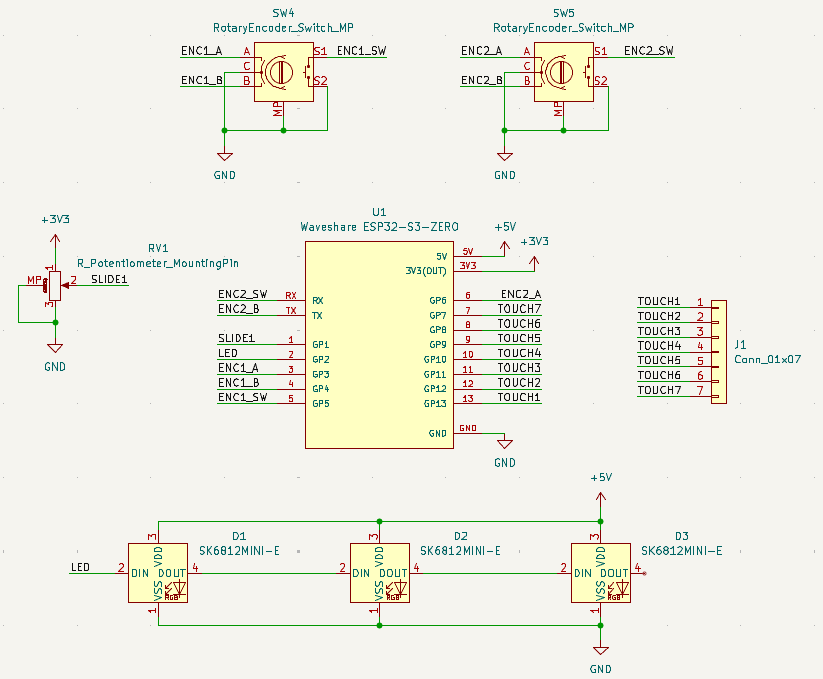
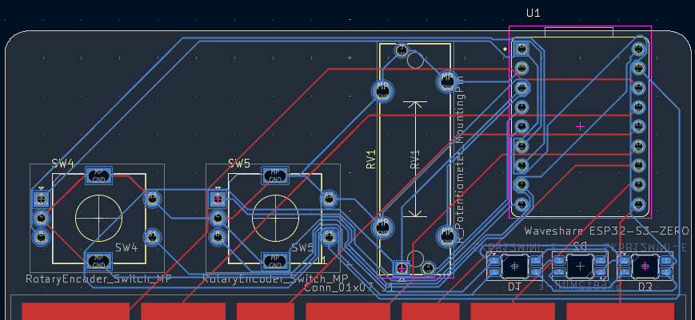
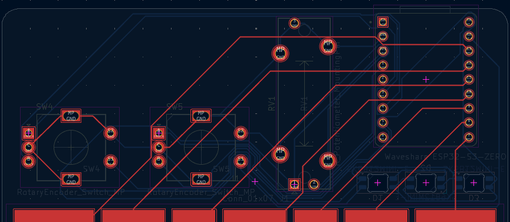
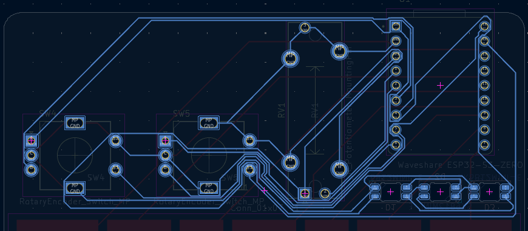

# HalfLifeWeek3-Music
Guide: https://github.com/KaiPereira/MIDI-Keypad/blob/master/README.md

I followed the guide to create the MIDI keypad. However, I made some changes. I added a second encoder, and since I decided to use both encoders clicking functionalities, I had to remove the low-profile switches and a slider to make room on the ESP32. The remaining slider is used for volume, the first encoder for changing octaves, and the second encoder for adding a modulation effect. This is the final result of how the PCB looks like:

This is the final schematic:

And this is the wiring:

