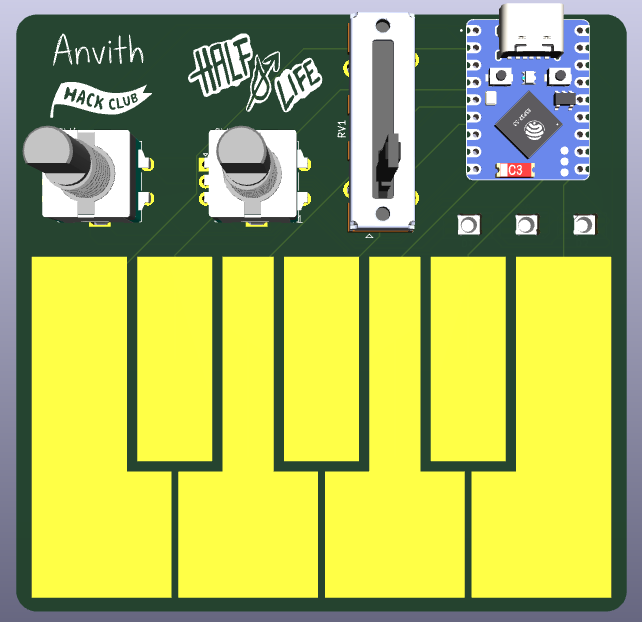

# HalfLifeWeek3-Music
Guide: https://github.com/KaiPereira/MIDI-Keypad/blob/master/README.md

I followed the guide to create the MIDI keypad. However, I made some changes. I added a second encoder, and since I decided to use both encoders clicking functionalities, I had to remove the low-profile switches and a slider to make room on the ESP32. The remaining slider is used for volume, the first encoder for changing octaves, and the second encoder for adding a modulation effect. This is the final result of how the PCB looks like:

**3D Model / Final PCB Render:**

**Schematic:**

**Board Layout & Routing:**

Combined Layout:

Front Copper Layer:

Back Copper Layer:

**What it is and how it works:**

This project is a MIDI keyboard built around the Waveshare ESP32-S3-Zero microcontroller. All of the components fit together on a single two-layer PCB:

* **Waveshare ESP32-S3-Zero:** Kind of like the brain of the board. It reads all touch, switch, encoder, and analog inputs and sends USB MIDI messages to a computer or DAW.
* **Capacitive Touch Keys:** There are 7 copper pads in the front layer of the PCB. The ESP32-S3's built-in capacitive touch pins detect when your finger touches a pad to trigger MIDI note-on and note-off events.
* **2 EC11 Rotary Encoders:** One encoder adds a modulation effect, while the second encoder shifts the keypad's active octave up and down.
* **Slide Potentiometer:** Connected to the ESP32-S3's ADC pins and changes the volume.
* **3 SK6812 MINI-E NeoPixels:** RGB LEDs on the back that shine through holes in the PCB. They light up in different colors to indicate button presses and also show the current octave.

**Why I made it:**

I made this project to get more experience with KiCad PCB design (specifically working with custom footprints like capacitive touch pads and reverse-mount LEDs). Just like in Week 1, I wanted to push past the basic guide by adding both hardware and software upgrades.

**How to assemble and flash the firmware:**

**1. How to flash the firmware**
You can flash this board using the Arduino IDE (or CircuitPython/KMK):

1. Install the Arduino IDE.
2. In the Boards Manager, install the ESP32 boards package by Espressif and select Waveshare ESP32-S3-Zero (or ESP32S3 Dev Module) as your board.
3. Under the Tools menu, set USB Mode to USB-OTG (TinyUSB) and USB CDC On Boot to Enabled so the board is recognized as a native USB MIDI device.
4. Install these libraries in the Library Manager:
   * Adafruit TinyUSB Library (or Control Surface / MIDI library)
   * Adafruit NeoPixel
   * ESP32Encoder
5. Open midi-keyboard-arduino/midi-keyboard-arduino.ino, plug the board into your computer via USB-C, and click Upload. If it doesn't upload automatically, hold the BOOT button on the ESP32-S3-Zero, tap RESET, and release BOOT to enter bootloader mode.

**2. How to assemble the board**
To assemble the keypad, you need a soldering iron, solder, flux, tweezers, and flush cutters. Solder the components from shortest/surface-mount to tallest/through-hole:

1. **SK6812 MINI-E NeoPixels:** These are on the back of the PCB so they shine through the front holes. Align the angled/notched corner of each LED with the ground/orientation mark on the silkscreen, put one pad down, check that it sits flat over the hole, and solder the remaining three pads.
2. **Waveshare ESP32-S3-Zero:** Place it on its footprint with the USB-C port facing outward toward the top edge of the board. Solder one corner pin first to check alignment, then solder the rest of the pins and check for solder bridges.
3. **EC11 Rotary Encoders:** Push the mounting legs and signal pins through the front of the PCB. Bend the two large side mounting tabs slightly if needed to hold them flush, then solder the 3 signal pins, 2 switch pins, and mounting tabs on the back.
4. **Slide Potentiometer:** Insert the slide potentiometer on the front of the board, make sure it sits completely straight and flat, and solder all pins on the back.
5. **Knobs:** Push the knobs onto the rotary encoders and slide potentiometers.

Before plugging in the USB-C cable, use a multimeter in continuity mode to make sure 3V3/5V and GND are not shorted. Once verified, plug it in, flash the firmware, and test the capacitive keys and encoders!
